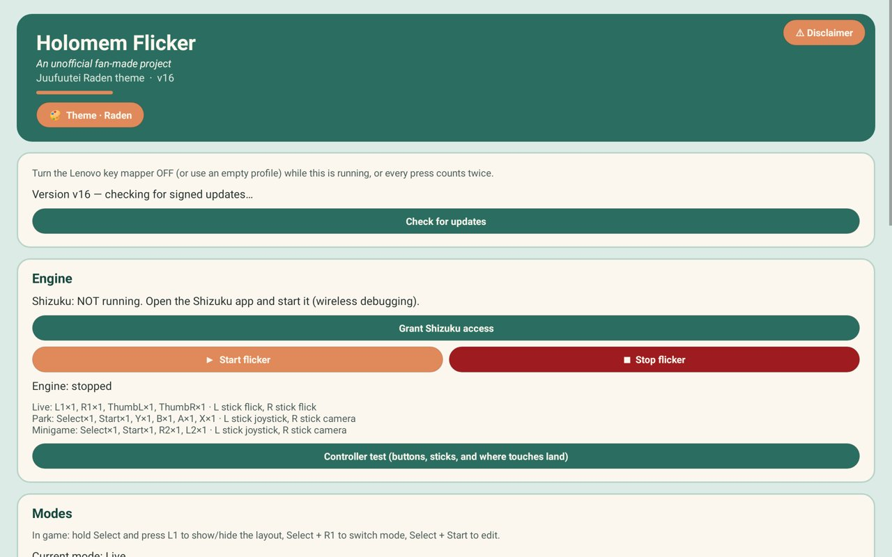
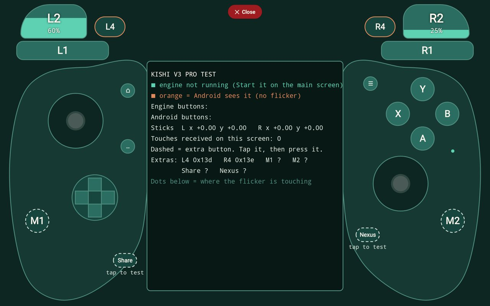
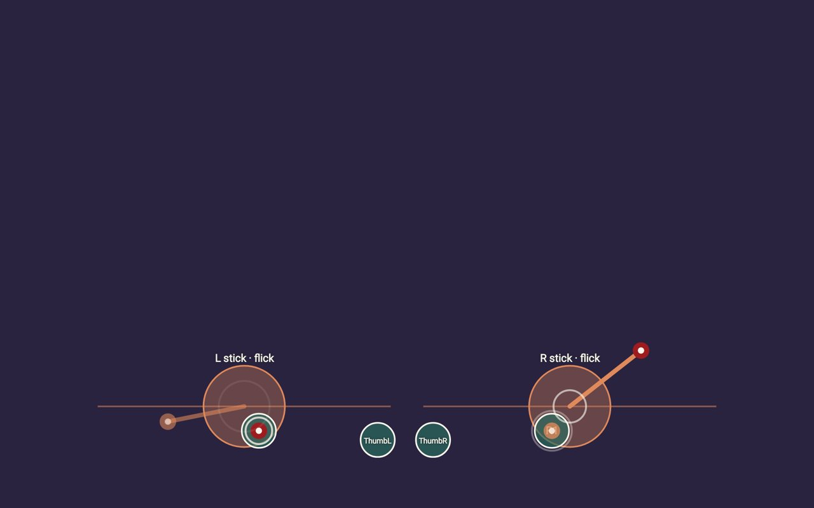
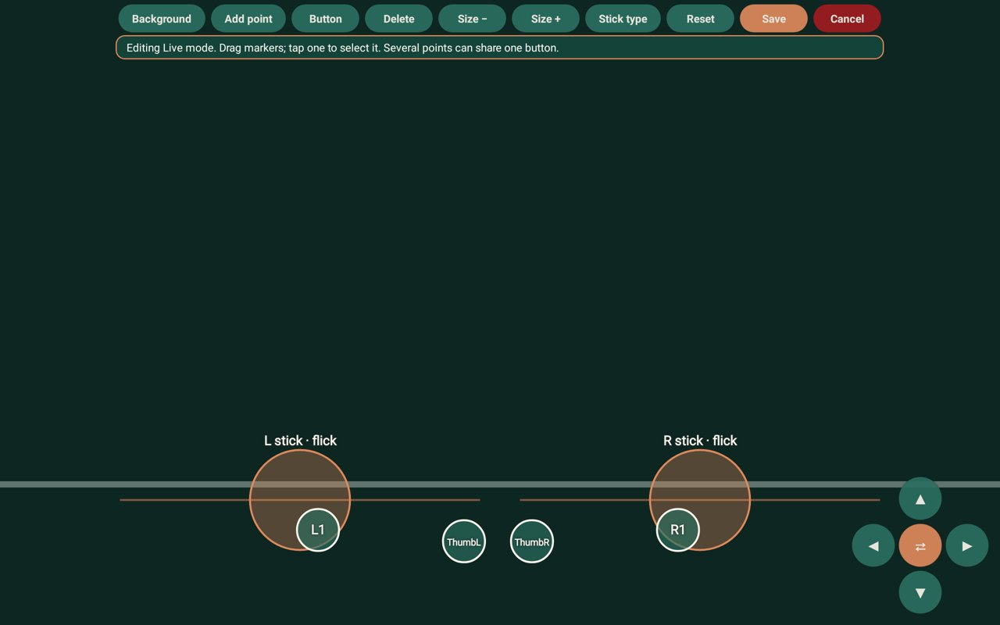
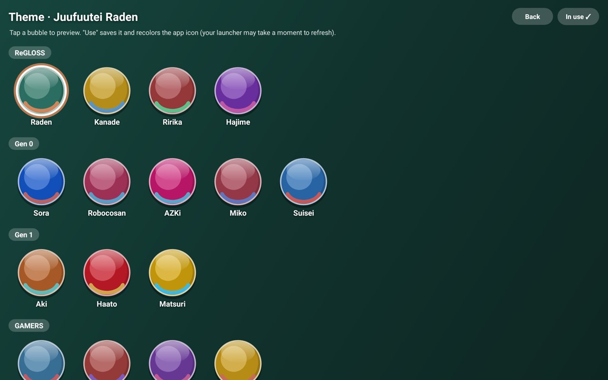

# Holomem Flicker – Setup guide

*An unofficial fan-made project. Not affiliated with or endorsed by COVER Corporation, hololive production, QualiArts, Razer, Lenovo or the Shizuku project.*

Holomem Flicker turns a game controller into touches for **hololive Dreams** on Android: buttons tap, sticks flick.
This guide takes you from nothing to playing a song, then covers customizing, updating and fixing problems.

> **Read the in-app disclaimer first.** Use the app at your own risk. Controller mappers may be against a game's rules,
> and the developer(s) aren't responsible for bans, damage or lost data. Holomem Flicker was built with Claude, Anthropic's AI.

**Contents**
1. [What you need](#1-what-you-need)
2. [Install and start Shizuku](#2-install-and-start-shizuku)
3. [Install Holomem Flicker](#3-install-holomem-flicker)
4. [Start the flicker](#4-start-the-flicker)
5. [Turn off other key mappers](#5-turn-off-other-key-mappers)
6. [Check your controller](#6-check-your-controller)
7. [Modes and controls](#7-modes-and-controls)
8. [Customize your layout](#8-customize-your-layout)
9. [Tuning](#9-tuning)
10. [Sleep and battery](#10-sleep-and-battery)
11. [Updates](#11-updates)
12. [Backup, themes and extras](#12-backup-themes-and-extras)
13. [Troubleshooting](#13-troubleshooting)
14. [Turning it off and uninstalling](#14-turning-it-off-and-uninstalling)

---

## 1. What you need

- An Android phone or tablet running **Android 11 or newer** (Wireless debugging needs Android 11).
- **Wi-Fi.** Wireless debugging only works while you're connected to Wi-Fi.
- A **game controller** that Android recognises: a clip-on one like the Razer Kishi, or a Bluetooth/USB pad.
  The app is tuned for the **Kishi V3 Pro** on a **Lenovo Legion Tab**; other controllers and screens work, but you may need to adjust the layout (section 8).
- **hololive Dreams** installed.
- About 10 minutes for the first setup.

## 2. Install and start Shizuku

[Shizuku](https://shizuku.rikka.app/) gives Holomem Flicker the access it needs to read your controller while the game is open and to send touches to the game. No root needed.

**One-time setup**
1. Install **Shizuku** from the Play Store (or from its GitHub releases).
2. Turn on **Developer options**: open *Settings → About phone/tablet* and tap **Build number** 7 times.
   (On some devices it's under *About → Software information*.)
3. Open *Settings → System → Developer options* and turn on **Wireless debugging**. Allow it for your current Wi-Fi network if asked.
4. Open Shizuku and choose **Start via Wireless debugging → Pairing**. Shizuku shows a notification waiting for a code.
5. Back in *Developer options → Wireless debugging*, tap **Pair device with pairing code**. A 6-digit code appears.
6. Pull down the notification shade and type that code into **Shizuku's notification**. It should say pairing succeeded.
7. In Shizuku, tap **Start**. The top of the app should say **Shizuku is running**.

**After every restart of your device**, Shizuku stops. You don't need to pair again, just:
turn **Wireless debugging** on (with Wi-Fi connected), open Shizuku, tap **Start**.

> Menu names vary a little between phone makers. If you get stuck, Shizuku's own guide (in the app, *Learn more*) has screenshots for most devices.

## 3. Install Holomem Flicker

1. On your device, open the project's **[Releases page](https://github.com/Ozyman515/holomem-flicker/releases)** and download the newest
   `holomem-flicker-vN.apk` that has a signed manifest (the app tells you which is current once installed).
2. Open the downloaded file. Android will ask you to allow your browser or Files app to **install unknown apps** – allow it, then tap **Install**.
3. Open **Holomem Flicker**. The **disclaimer** appears first; read it and tap **I understand and accept** (or **Close app** if you don't agree).

## 4. Start the flicker

On the main screen, in the **Engine** card:

1. Tap **Grant Shizuku access** and choose **Allow** in Shizuku's prompt. The card should change to **"Shizuku: ready ✓"**.
2. Tap **▶ Start flicker**.
   - The app gives itself **"Display over other apps"** through Shizuku (needed for the on-screen layout).
   - On Android 13+, allow **notifications** when asked.
3. A notification appears: **"Holomem Flicker is running"**. The engine status shows which controller it's listening to.

Now open hololive Dreams. The flicker keeps running in the background until you tap **■ Stop flicker**.

## 5. Turn off other key mappers

If another mapper is also turning your controller into touches – for example **Lenovo's Legion game assistant** – every press lands twice.
Either turn that mapper off (or give it an empty profile) while you play, or let Holomem Flicker do it for you:

- In the **Lenovo mapper** card, tap **Pick the mapper app to stop on Start** and choose it from the list.
  From then on, **Start flicker** closes that app automatically. **Don't stop any app** turns this off.

## 6. Check your controller

Tap **Controller test (buttons, sticks, and where touches land)** in the Engine card.

- Press buttons and move both sticks: the drawing lights up and the stick numbers move.
- With the flicker running, **dots show where the flicker is touching**, so you can check flicks before playing.
- **Extra buttons** (Kishi V3 Pro **L4, R4, M1, M2, Share, Nexus**) are dashed: tap one on the drawing, then press it on the controller, so the app learns it and you can map it.

Also useful, in the **Live input** card on the main screen:
- **Test touch** taps the box below it by itself – if it says *"✓ Touch received! Injection works."*, touches reach apps.
- If the **right stick** doesn't move in the readout, tap **Right stick axes** (in the Tuning card) until it does – controllers report the right stick differently.
- **List input devices** shows what Android sees, handy for bug reports.

## 7. Modes and controls

The flicker has three **modes**, each with its own layout. Pick one on the main screen (**Live / Park / Minigame**) or switch in game.

| Mode | Default buttons | Sticks |
|---|---|---|
| **Live** (songs) | **L1** / **R1** tap the left / right side of the judgment line; **ThumbL** / **ThumbR** (stick clicks) tap the middle | Both sticks **flick** |
| **Park** (walking around) | **Select** map · **Start** menu · **Y / B / A** the three on-screen prompts · **X** jump | Left stick **walks** (joystick), right stick turns the **camera** |
| **Minigame** | **Select**, **Start**, **R2**, **L2** | Joystick + camera |

**In-game combos** (hold **Select**, then press):

| Combo | Does |
|---|---|
| **Select + L1** | Show / hide the layout overlay (with live dots and trails of every touch) |
| **Select + R1** | Next mode (a banner shows the mode name) |
| **Select + Start** | Open the in-game layout editor |

Buttons pressed while Select is held never tap. **Select on its own** still taps if it's mapped (on release).

**How flicks work:** pushing a stick puts a finger down at that side's flick point and drags it the way you pushed, like a quick swipe.
Pushing sideways also shifts where the flick starts (**edge reach**), so you can reach the outer lanes.

## 8. Customize your layout

Each point is a circle: holding its button holds a finger there, and each press lands at a random spot inside the circle.
One button can have **several points** (one press, several fingers).

**In the app** – tap **Edit Live / Edit Park / Edit Minigame** on the main screen:

- **Background** – pick a screenshot from the game so the points line up with the real screen (take one mid-song first).
- **Drag** a point or stick circle to move it. Tap one to select it.
- **The d-pad** (bottom corner) moves the selected point **2 pixels per tap** – hold to repeat. The middle **⇄** button moves the d-pad to the other corner.
- **Add point** – then press the controller button for it. **Button** – reassign the selected point. **Delete** – remove it.
- **Size − / Size +** – shrink or grow the selected circle.
- **Stick type** – with a stick selected, cycles **flick → joystick → camera → off**.
- **Reset** – back to the default layout. **Save** / **Cancel**.

**In the game** – press **Select + Start**. The editor opens over the game (the game can't be touched while it's open):
tap empty space to add a point and press its button, tap a point to select and drag it, use the same d-pad and buttons, then **Save** or **Exit**.
Pressing **Select + Start** again also closes it and keeps your changes.

## 9. Tuning

In the **Tuning** card (tap **Start flicker** again afterwards to apply):

| Slider | What it changes |
|---|---|
| **Flick length** | How far each flick drags (% of screen width). Longer = more reliable flicks, shorter = faster. |
| **Edge reach** | How far sideways the flick start shifts when you push the stick sideways. |
| **Stick threshold (flick)** | How far you must push a stick before it flicks. Raise it if you get accidental flicks. |
| **Joystick size (Park)** | How far the walking joystick drags. |
| **Camera speed (Park)** | How fast the right stick turns the camera. |

## 10. Sleep and battery

- Nothing runs in the background while the controller is idle.
- After **one minute** without controller input, the flicker **sleeps**: the overlay hides and the notification says **"Holomem Flicker is sleeping"**.
- **Any button, stick or d-pad press wakes it instantly**, and that press still reaches the game.
- To check battery use: *Settings → Battery → App battery usage* – look at **Holomem Flicker** and **Shizuku** (the engine runs inside Shizuku).

## 11. Updates

The app updates itself:
1. The top card checks GitHub for a new version. When one is ready it shows **Install signed update vN**.
2. Tap it (**Shizuku must be running**). The app downloads the update, checks its signature and fingerprint, installs it, and closes.
3. Reopen it. If the disclaimer changed, you'll be asked to accept it again.

Only updates signed by the project's private key are ever installed, and only from this repository – a fake or tampered update is refused.

## 12. Backup, themes and extras

- **Backup** card: **Back up to a file** saves all layouts and settings; **Restore from a file** loads them back (tap Start again afterwards).
- **🎨 Theme** (top of the main screen): pick a colour theme for the app and its launcher icon.
- **⚠ Disclaimer** (top right): read the disclaimer any time.

## 13. Troubleshooting

| Problem | Fix |
|---|---|
| "Shizuku: NOT running" / "Shizuku isn't ready yet" | Shizuku stops on every reboot. Turn on Wireless debugging (on Wi-Fi), open Shizuku, tap **Start**, then **Start flicker** again. |
| Every press counts twice | Another mapper (e.g. Lenovo's) is still on. See section 5. |
| Nothing happens in the game | Make sure the notification says *running* (not *sleeping* – press any button). Try **Test touch** in the Live input card. |
| The right stick does nothing | Tap **Right stick axes** in the Tuning card until the right stick moves in the Live input readout. |
| Flicks miss or hit the wrong lane | Edit the Live layout with a game screenshot as background (section 8), then adjust **Flick length** / **Edge reach**. |
| Accidental flicks | Raise **Stick threshold (flick)**. |
| The layout overlay won't show | Tap **Start flicker** again (it re-grants "Display over other apps"), then **Select + L1**. |
| Update fails | Shizuku must be running during the update. Start it and try again. |
| Something else | Open an issue on GitHub with your device, controller, Android version and the output of **List input devices**. |

## 14. Turning it off and uninstalling

- Tap **■ Stop flicker** when you're done playing.
- **Turn Wireless debugging off** when you're not using the flicker – it's what gives Shizuku its access.
- To remove everything, uninstall Holomem Flicker (and Shizuku if you don't use it for anything else).

---

Holomem Flicker is free software under the [GNU General Public License v3.0](../LICENSE).
